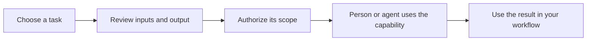

  
  <h1>SilexHub</h1>
  
<strong>Professional tools and data for AI</strong>

  
Bring traceable data, domain knowledge, and specialist tools into the AI you already use.

  

    <a href="https://silexhub.com">Website</a> ·
    <a href="https://github.com/silexhub/docs">Docs</a> ·
    <a href="https://github.com/silexhub/mcp-server">MCP</a> ·
    <a href="#capabilities">Capabilities</a> ·
    <a href="#getting-started">Get started</a> ·
    <a href="https://github.com/silexhub/silexhub/issues">Request a capability</a> ·
    <a href="README.zh-CN.md">简体中文</a>
  

  

    
    
  

---

Our first product preview covers geographic revenue for U.S.-listed semiconductor companies. You can see [NVIDIA’s reported and restated figures alongside the SEC filings](https://silexhub-prelaunch.1255829396.workers.dev/en/).

A useful agent needs more than a model. It needs the right information, a way to act, and an output that fits the next step. SilexHub's focus is the task between those steps: clear inputs, a defined scope, and a usable result.

This is the **official SilexHub developer hub**. Start here for the product overview, availability, and published integration resources.

## Why SilexHub?

- **Start with the job.** Find a capability by the task it helps complete and the result it delivers.
- **Know what goes in and comes out.** Understand the required input, output format, scope, and limits before using a capability.
- **Fit the workflow.** A downloadable asset, a tool call, and a software connection solve different jobs. The delivery format should follow the task.
- **Keep people in control.** People choose what to use and authorize access; agents use capabilities within that scope.

These are the principles guiding the product. The availability table below distinguishes the public materials available today from integrations still in development.

## Capabilities

<table>
  <tr>
    <th align="left">Tools</th>
    <th align="left">Data</th>
    <th align="left">Software connections</th>
  </tr>
  <tr>
    <td>Turn a defined input into a useful result: transform, check, compare, or produce an artifact.</td>
    <td>Bring structured information, datasets, and knowledge assets into a task.</td>
    <td>Use authorized software actions as part of a larger workflow.</td>
  </tr>
  <tr>
    <td><strong>Focus:</strong> the task and its output.</td>
    <td><strong>Focus:</strong> source, scope, format, and version.</td>
    <td><strong>Focus:</strong> permission, action, and result.</td>
  </tr>
</table>

Depending on the capability, delivery may be a file, a structured result, a reusable workflow, or an integration. Supported formats and access methods will be documented with each release.

## What could you build?

These scenarios illustrate the product direction; they are **not a released product catalog**.

| Workflow | Input you bring | Result you need |
| --- | --- | --- |
| Prepare information for an agent | Source material and a target structure | A structured artifact ready for the next step |
| Check and compare business information | Records, fields, and comparison rules | A clear comparison with differences to review |
| Add domain context to a task | A question and a defined information scope | Relevant data or knowledge with its source and version |
| Carry a result into another tool | An approved action and the required fields | A software action with a result you can inspect |

Have a specific job in mind? [Describe the workflow](https://github.com/silexhub/silexhub/issues/new) with the input, desired output, and where it should fit. Small, concrete tasks help us decide what to build first.

## How it fits together

| For people | For agents and developers |
| --- | --- |
| Discover capabilities, review examples, choose access, and retrieve results. | Understand the contract, supply the input, and consume the result through a supported integration. |

SilexHub is being designed around this shared flow. Each capability's documentation will explain its access, usage rules, and failure behavior.

## Availability

| Resource | Status |
| --- | --- |
| Website in English and Chinese | [English](https://silexhub.com/en) · [中文](https://silexhub.com) |
| Articles and product guides | [Articles](https://silexhub.com/en/articles) · [Guides](https://silexhub.com/en/docs) |
| Read-only workspace demo | [Try the demo](https://silexhub.com/en/demo) with synthetic examples; no account required |
| Accounts and workspace | In development on the public site |
| Product overview and English / Chinese README | Available in this repository |
| Product documentation and MCP integration materials | [Docs](https://github.com/silexhub/docs) · [MCP hub](https://github.com/silexhub/mcp-server) |
| Public questions and capability requests | [GitHub Issues](https://github.com/silexhub/silexhub/issues) |
| Paid capability catalog | Not released |
| Public API, MCP endpoint, or installable SDK | Not released |
| Runnable integration quick starts | To be published with the corresponding integration |

**The website and read-only demo are available.** Explore the samples, articles and product guides without an account. Checkout, paid capabilities, the public API, MCP service and installable SDK remain in development.

## Getting started

1. **Explore a sample.** Open the [read-only demo](https://silexhub.com/en/demo) or [product guides](https://silexhub.com/en/docs), then review the capability areas and workflow scenarios above.
2. **Tell us the job.** [Open a capability request](https://github.com/silexhub/silexhub/issues/new) with a concrete task and a small synthetic example.
3. **Follow published updates.** Watch this repository and return to the availability section for verified integration links.

A useful request includes:

- The task you want to complete and who uses the result.
- The input you can provide and the output format you need.
- Where the capability should fit: a manual task, an agent, or an existing application.
- Constraints that change the solution, such as update frequency or required permissions.

Use synthetic examples in public issues. Keep access credentials, customer records, and confidential material out of them.

## What to expect from an integration

Before a capability is presented here as usable, its documentation should answer:

| Question | Documentation |
| --- | --- |
| What does it do? | A concrete task, supported scope, and limitations |
| What do I send and receive? | Required inputs, output format, and a worked example |
| How do I connect? | The supported access method and authentication steps |
| What does usage mean? | The applicable usage unit, limits, and pricing when offered |
| What if it fails? | Error behavior, retry guidance, and result retrieval |
| Can I try it? | A tested quick start for the released integration |

## Frequently asked questions

<strong>Is SilexHub a tool, a dataset, or a marketplace?</strong>

SilexHub is the product brand for capabilities we build and provide: tools, data, and software connections. The current model is a first-party offering; third-party seller onboarding is not part of the current product.

<strong>Can I connect an agent through MCP today?</strong>

A public MCP service has not been released. Supported clients and tested configuration will be linked here when an integration is available.

<strong>Can I clone this repository to self-host the application?</strong>

This repository is the public developer hub and contains documentation and approved brand assets. It does not contain the hosted application or a self-hostable service distribution.

<strong>Where should I ask a question or suggest a correction?</strong>

Use [GitHub Issues](https://github.com/silexhub/silexhub/issues) for public product questions, capability requests, and documentation feedback. Documentation corrections can also be proposed as a pull request.

## Around SilexHub

| Link | Purpose |
| --- | --- |
| [SilexHub organization](https://github.com/silexhub) | Official GitHub presence and public repository navigation |
| [Developer hub](https://github.com/silexhub/silexhub) | Product information and published integration resources |
| [Documentation](https://github.com/silexhub/docs) | Getting started, concepts, workflows, and availability |
| [MCP integration](https://github.com/silexhub/mcp-server) | Connection guidance, capability contracts, and release requirements |
| [简体中文](README.zh-CN.md) | Chinese product overview and availability |
| [Product domain](https://silexhub.com) | SilexHub's product website address |

---

  <strong>SilexHub</strong> 
  Tools. Data. Software connections. 
  <a href="#silexhub">Back to top ↑</a>

